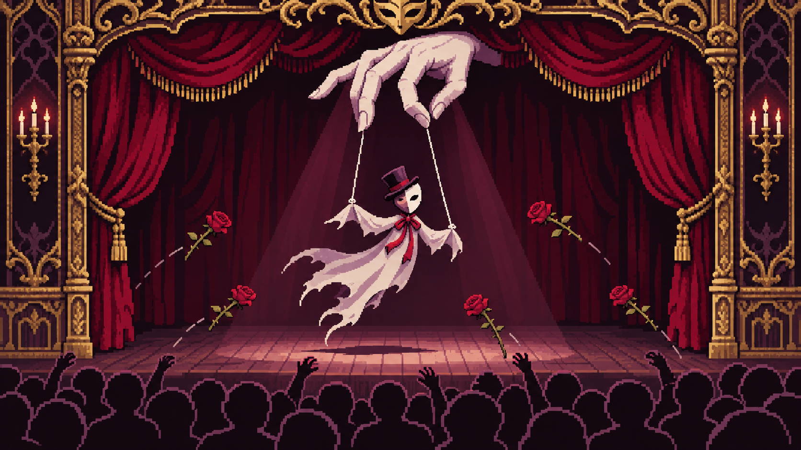

Todo empezó con una idea sencilla: un fantasma sobre el escenario de una ópera tiene que esquivar las rosas que le lanza el público. Cuanto más tiempo sobrevive, más rosas vuelan y más deprisa lo hacen.

La idea ganó personalidad cuando decidimos que el fantasma —un personaje sin género— no se movería por sí solo. Una mano gigantesca lo controlaría desde arriba como una marioneta. El jugador sería esa mano, y los hilos transmitirían balanceo, tensión e inercia al cuerpo. De pronto ya no era solo un juego de esquivar objetos: era una pequeña representación de terror teatral.

## Diseñar antes de programar

Antes de escribir el juego, trabajamos el arte en pixel art. Definimos el escenario, las cortinas, el público, la mano, el fantasma y las rosas, y fuimos validando cada elemento tanto ampliado como a su tamaño real. Esa segunda vista fue esencial: algo que funciona en una ilustración grande puede resultar ilegible en un sprite de pocos píxeles.

También refinamos las animaciones. Cuando el cuerpo se desplazaba, la cabeza debía inclinarse ligeramente en sentido contrario; la parte superior de la mano debía reaccionar del mismo modo. Eliminamos una capa de iluminación que añadía ruido y simplificamos algunas poses hasta que el movimiento se sintió más natural.

Esta ilustración conceptual nos ayudó a fijar la composición, la paleta y el tono del teatro. Después hubo que traducir esa ambición a un juego legible en una pantalla lógica de solo 480×270 píxeles.

## La música también forma parte del diseño

No quisimos dejar el sonido para el final. Con ElevenLabs generamos varias piezas y elegimos **Candela** para los menús, **Espejo** para la partida y **Telón** para el cierre. El mayor reto fue Espejo: al repetirla, el final tenía demasiada intensidad y chocaba con un comienzo más calmado.

Probamos un crossfade, pero sonaba atropellado. La solución fue extender la pieza mediante _inpainting_ y pedir que el tramo final actuara como un puente hacia los primeros segundos. Después recortamos un pequeño silencio sobrante. También generamos y seleccionamos efectos concretos para la tensión de las cuerdas, el lanzamiento y paso de las rosas y los impactos cercanos.

## De prototipo a juego móvil

Elegimos construirlo como una PWA horizontal: se abre desde una web, funciona en Android y iPhone y puede instalarse sin pasar por las tiendas. Para que el dedo no tape al personaje, se puede tocar y arrastrar desde cualquier parte de la pantalla; al soltar, la mano se detiene, pero el fantasma conserva su balanceo.

Aquí fue fundamental probar en dispositivos reales. Mis hijos, **Max y Teo**, fueron parte del proceso como jugadores y banco de pruebas. Gracias a esas pruebas encontramos detalles que las simulaciones no habían revelado: iOS necesitaba un gesto explícito para activar el audio, así que convertimos esa limitación en una pantalla teatral de «Toca para abrir el telón». En Android descubrimos que la pantalla completa debía solicitarse al soltar el dedo y no al apoyarlo.

## Lo que aprendimos

- Validar arte y sonido antes de programar evita construir sobre decisiones todavía débiles.
- La IA acelera la creación de alternativas, pero la dirección, la selección y los pequeños ajustes siguen siendo lo que da coherencia al resultado.
- Una prueba automatizada no sustituye a una persona jugando en un dispositivo real.
- Las limitaciones técnicas pueden convertirse en parte de la experiencia si encajan con la ficción del juego.

El resultado ya se puede jugar: [Juega a Fantasma de la Ópera](https://israelgutierrez.es/fantasma-de-la-opera/). Y, como en toda buena función, el siguiente paso es seguir ajustando el ritmo según reaccione el público.
